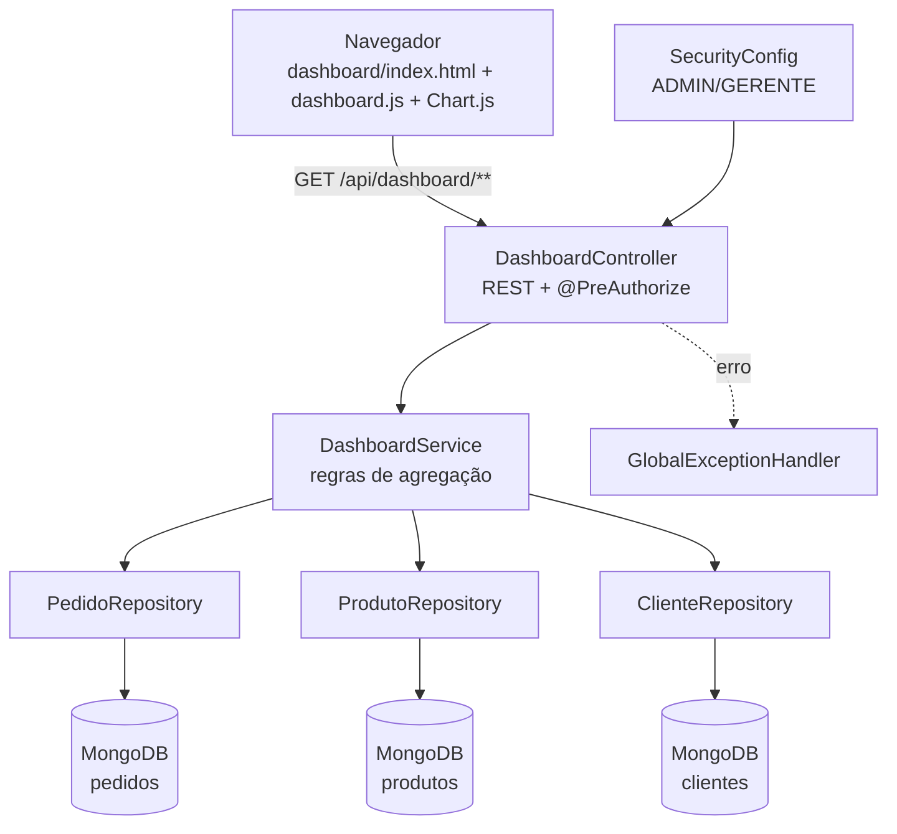
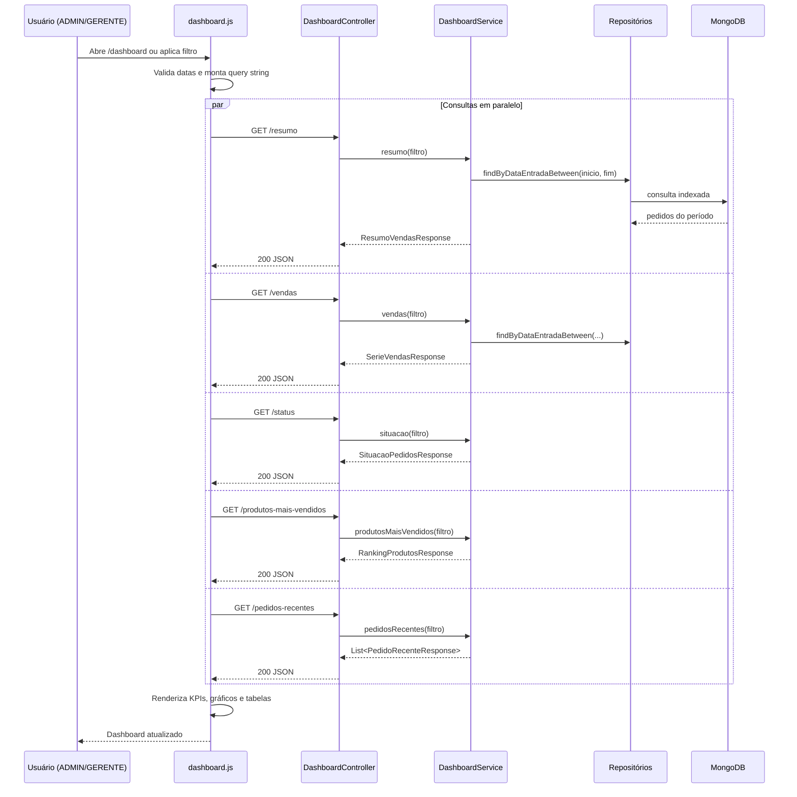
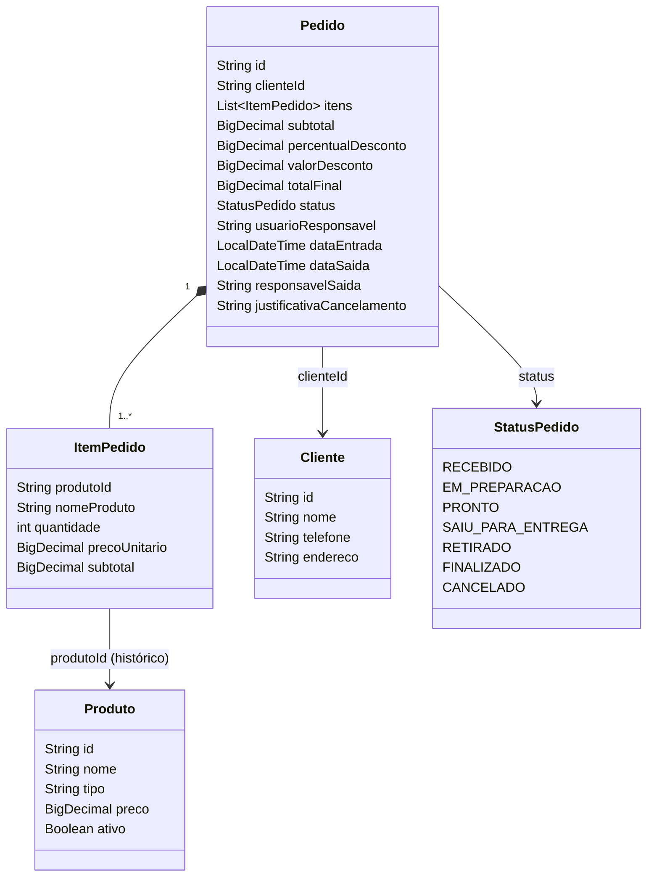

# Arquitetura — Dashboard Administrativo

## 1. Visão em camadas



- **Apresentação:** página Thymeleaf (`templates/dashboard/index.html`) + `static/js/dashboard.js` + `static/css/dashboard.css`. Chart.js 2.9.4 é servido localmente em `/plugins/chart.js/Chart.min.js`.
- **API:** `DashboardController` expõe seis endpoints GET e delega todo cálculo ao service.
- **Domínio/serviço:** `DashboardService` concentra período padrão, validações, filtros, agregações e formatação dos DTOs.
- **Persistência:** repositories Spring Data MongoDB. O período é aplicado na consulta (`findByDataEntradaBetween`), reduzindo o volume lido.
- **Segurança:** `SecurityConfig` protege `/dashboard` e `/api/dashboard/**`; o controller reforça com `@PreAuthorize`.
- **Erros:** `GlobalExceptionHandler` padroniza respostas JSON.

## 2. Fluxo de uma consulta



## 3. Modelo de dados relevante



### Índices

| Coleção | Campo | Motivo |
|---|---|---|
| `pedidos` | `dataEntrada` | Filtro de período do dashboard |
| `pedidos` | `status` | Filtro/contagem por situação |
| `produtos` | `_id` (padrão) | Busca de categoria no ranking |
| `clientes` | `_id` (padrão) | Nome do cliente em pedidos recentes |

As anotações `@Indexed` em `Pedido` criam os índices automaticamente na inicialização (desde que a aplicação tenha permissão de escrita no banco).

## 4. Decisões de projeto

### 4.1 Consulta filtrada no banco, agregação no service

O período é resolvido e enviado ao MongoDB via `findByDataEntradaBetween`, evitando carregar toda a coleção. A partir dos pedidos do período, o service agrega em memória.

**Por quê:** mantém o código testável sem depender de um MongoDB em execução, preserva compatibilidade com dados antigos e permite calcular métricas que envolvem múltiplas regras (variação, participação, ticket médio) com clareza. Para volumes muito grandes, a evolução natural é mover as agregações para pipelines do MongoDB (`$match`, `$unwind`, `$group`), mantendo o mesmo contrato da API.

### 4.2 Cancelados fora das vendas

Pedido cancelado é preservado no banco (requisito de auditoria), mas não representa receita. A regra é centralizada em `apenasVendas()` e aplicada em resumo, série, ranking e ticket médio. A situação dos pedidos continua contando cancelados, pois é informação operacional.

### 4.3 Período inclusivo e limite

- `dataInicio.atStartOfDay()` até `dataFim.atTime(LocalTime.MAX)`.
- Máximo de 731 dias para proteger a API e o banco.
- Limite de 1–50 no ranking/recentes.
- Datas inválidas ou invertidas retornam 400 com mensagem em português.

### 4.4 Variação percentual

O período anterior tem exatamente a mesma quantidade de dias e termina no dia anterior ao início do período atual. Se a base anterior é zero, a variação é 100% quando há faturamento atual e 0% quando ambos são zero — evitando divisão por zero e `NaN`.

### 4.5 Série contínua

O service cria os buckets antes de agregar e preenche os ausentes com zero. Isso evita gráficos com “buracos” e mantém a escala temporal correta.

### 4.6 Front-end desacoplado

A página não recebe dados do controller Thymeleaf; ela carrega tudo via API. Benefícios:

- mesma API pode alimentar outros clientes (app, BI);
- atualização periódica sem recarregar a página;
- testes de contrato independentes da renderização.

### 4.7 Segurança

- Rotas e métodos protegidos em duas camadas (`SecurityConfig` + `@PreAuthorize`).
- Nenhum endpoint de escrita no dashboard.
- CSRF continua ativo para POSTs; os GETs do dashboard não alteram estado.
- Erros de autorização retornam 403 JSON.

### 4.8 Dados de demonstração

`DataInitializer` cria usuários, produtos, clientes e ~60 dias de pedidos **somente quando as coleções estão vazias**. A flag `app.demo-data.enabled` (env `DEMO_DATA`) permite desligar. Isso viabiliza a avaliação do dashboard em uma instalação limpa sem sobrescrever dados reais.

## 5. Estrutura de pacotes

```
com.umc.pediupatrao
├── config/          SecurityConfig, DataInitializer, MongoInitConfig
├── controller/      DashboardController, PedidoController, HomeController...
├── dto/
│   └── dashboard/   DashboardFiltro, Agrupamento e responses (records)
├── entity/          Pedido, ItemPedido, Cliente, Produto, StatusPedido...
├── infra/           GlobalExceptionHandler, exceções de negócio
├── repository/      PedidoRepository, ProdutoRepository, ClienteRepository...
└── service/         DashboardService, PedidoService, AuditoriaService...
```

## 6. Estratégia GitFlow

```
main
 └── develop
      └── feature/dashboard-admin-api   (implementação)
           └── merge --no-ff em develop
                └── release/1.0.0       (documentação e ajustes finais)
                     ├── merge --no-ff em main + tag v1.0.0
                     └── merge de volta em develop
```

- `main`: versão estável/entregável.
- `develop`: integração contínua.
- `feature/dashboard-admin-api`: API, página, testes e dados demo.
- `release/1.0.0`: documentação, evidências e ajustes finais.

## 7. Limitações e evoluções

- Não há autenticação JWT; o dashboard usa a sessão do sistema existente.
- Não há paginação no ranking (limite máximo de 50) nem cache HTTP.
- A agregação em memória é adequada ao porte acadêmico; para alto volume, migrar para aggregation pipelines.
- Não há exportação CSV/PDF nesta versão (evolução possível).
- Não há comparativo entre filiais/canais porque o modelo atual não possui esses campos.
